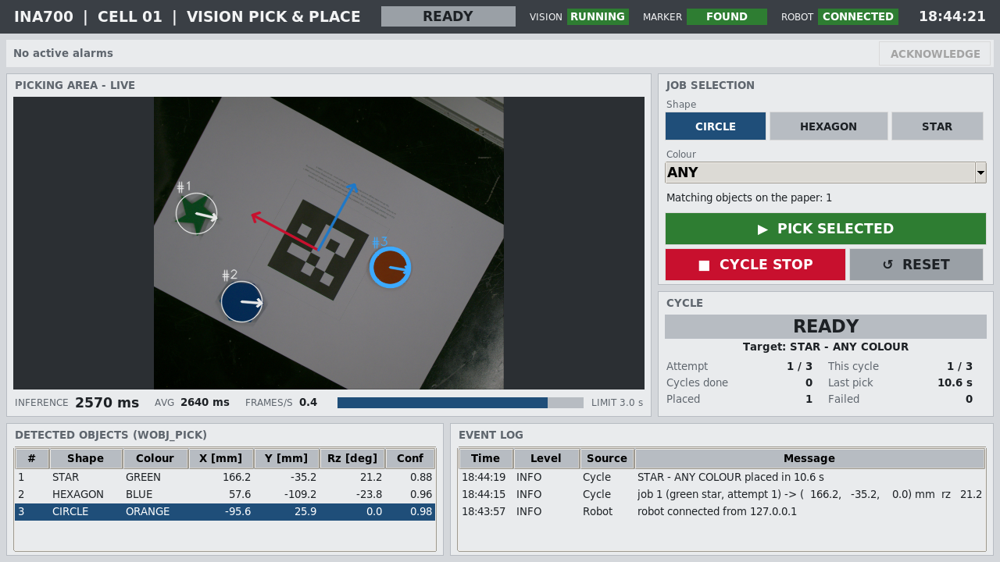

# Vision-Guided Pick and Place

[](https://github.com/atakangudulluogluhv/ina700-vision-pick-and-place/actions/workflows/tests.yml)

Final project for INA700 at University West. A Raspberry Pi 4 with a Basler
camera finds plastic plates on a sheet of paper, works out where they are and
how they are rotated, and sends the targets to an ABB IRB 1600 robot, which
picks each plate with a vacuum gripper and drops it into a matching cavity
in a fixture.

Three shapes are assigned (circle, hexagon, star). Two other shapes are on
the table as distractors and must be ignored. The operator chooses which
shape and colour to pick next from the HMI.



## How it works

```
Basler camera ─► CaptureWorker ─► InferenceWorker ─► TransformWorker ─► SceneStore
                                   YOLO26n-OBB        pixel → robot mm,         │
                                   (ONNX)             symmetry-aware angle      ▼
Operator HMI (Tk) ──────────────► CycleController ──► RobotLinkWorker ──► ABB robot (TCP)
  shape + colour                  pick → verify → retry
```

Each stage runs in its own thread and talks to the next through a bounded
queue, so a slow frame never blocks the HMI.

**Detection.** A YOLO26n oriented-bounding-box model, trained on my own
dataset and exported to ONNX. The Pi runs it with `onnxruntime` only, without
torch. An OBB gives class, centre and box angle in one pass, but the box
angle can't tell which way a star is pointing, so the heading is measured
afterwards from the plate's contour inside the box
(`src/vision/orientation_refiner.py`).

**Dataset.** 197 frames captured in the lab, labelled offline with a
classical-CV pipeline (`tools/auto_label.py`) and split into train and
validation sets with a fixed seed.

| | |
|---|---|
| mAP50 / mAP50-95 (val) | 0.984 / 0.938 |
| Val objects found | 70 of 74, no wrong classes |
| Centre error (median) | 2.9 px, about 0.5 mm |

**Calibration.** One 100 mm ArUco marker sits on the paper and defines the
origin and axes of the robot's pick work object (`wobj2`). It is located in
every frame, so a bumped camera or a shifted sheet doesn't silently corrupt
the coordinates. The marker gives the mm-per-pixel ratio and the local axes
(`src/transform/coordinate_mapper.py`).

**Orientation.** Sending the raw angle would make the wrist turn more than it
needs to. The angle is folded by each shape's symmetry (hexagon 60°, star
72°, circle none) and the turn closest to neutral is chosen
(`src/transform/orientation.py`).

**Retry.** The gripper has no vacuum sensor. After the robot reports a pick,
a fresh frame is checked; if the plate is still there, the pick failed and
is retried, up to two times.

**Protocol.** One ASCII line per object, in strict lockstep. RAPID strings
are limited to 80 characters, so every message has to fit in that.

```
PICK;<id>;<shape>;<color>;<x_mm>;<y_mm>;<z_mm>;<rz_deg>
ACK;<id>;OK   |   ACK;<id>;FAIL
```

## Speed

The assignment limit is 3 s per frame, and the inference time has to be
shown. The first version took 1.7 s end to end on a Pi 3, almost all of it
in the ONNX session. Dropping the network input from 640 to 416 px more than
halved that, with no real loss in accuracy on the validation set:

| Input | Pi 3 `session.run` | Val objects found | Median centre error |
|-------|--------------------|-------------------|---------------------|
| 640 | 1373 ms | 70 / 74 | 3.0 px |
| 512 | 880 ms  | 65 / 74 | 2.8 px |
| 416 | 610 ms  | 72 / 74 | 3.3 px |

On the lab's Pi 4 with the 416 model the HMI shows 225–268 ms per frame.
(The screenshot above is from an earlier run on a Pi 3.)

## Status

The full loop runs on the real robot: live detection, operator selection,
picking, placing and retry. Remaining work:

- Picks are still a few mm off-centre; the last `wobj2` offset correction
  has not been verified on the robot yet.
- An unassigned triangle was once detected as a hexagon with confidence 0.53,
  just above the 0.5 threshold. The fix is to retrain with the distractor
  shapes as negatives.

## Running

On the Pi:

```bash
python -m src.app.station --fullscreen              # HMI + full pick cycle
python -m src.app.main --camera basler --no-robot   # camera and calibration only
python -m src.app.main --detector contour           # classical-CV fallback detector
```

Start the server before the RAPID program; the robot connects as the client.

Without hardware:

```bash
python -m src.app.station --camera file --source <image>   # terminal 1
python tools/fake_robot_client.py --host 127.0.0.1         # terminal 2, stands in for the robot
python -m pytest
```

The tests (pytest, no camera or robot needed) also run on every push through GitHub Actions.

| Tool | Purpose |
|---|---|
| `tools/train_yolo.py` | Train YOLO26n-OBB and export ONNX to `models/` |
| `tools/auto_label.py` | Offline OBB labelling of captured frames |
| `tools/tune_thresholds.py` | Tune segmentation thresholds and ROI live |
| `tools/aruco_probe.py` | Diagnose marker detection (dictionary, print quality, exposure) |
| `tools/fake_robot_client.py` | Python version of `robot/MainModule.mod` for socket tests |
| `tools/setup_pi.sh` | Pi setup: Python packages and the static IP on the robot subnet |
| `tools/make_submission.py` | Build and verify the hand-in ZIP (program, model, Pack-and-Go) |

## Setup

**PC** (development and training): Python 3.11+, `ultralytics>=8.4`, torch,
`opencv-contrib-python<5`, `onnxruntime`, `pypylon`, `pytest`. ABB RobotStudio
for the robot side.

**Raspberry Pi** (runtime): Raspberry Pi OS 64-bit. Only `onnxruntime`,
`opencv-contrib-python`, `pypylon` and `numpy` (`requirements-pi.txt`).

```bash
bash tools/setup_pi.sh --all
```

Install exactly one OpenCV package. `cv2.aruco` is in the contrib build, and
having `opencv-python` installed next to it breaks the import.

All tunable values (thresholds, offsets, network settings) are in
`config/settings.yaml`, so calibration in the lab doesn't need code changes.

| | |
|---|---|
| Camera | Basler ace 2 `a2A2448-75ucBAS`, 2448×2048 |
| Robot | ABB IRB 1600-6/1.2, IRC5 controller |
| Network | Pi `192.168.125.2:5000` (server), robot as client |

More on the robot side in [docs/ROBOT_SETUP.md](docs/ROBOT_SETUP.md) and
[docs/OFFSET_CALIBRATION.md](docs/OFFSET_CALIBRATION.md).

## Project structure

```
config/      settings.yaml
src/
  core/      config loading, interfaces, worker base classes
  app/       station.py (entry point), main.py (CLI), workers, cycle controller
  vision/    cameras, YOLO and contour detectors, ArUco, colour, orientation refiner
  transform/ pixel → robot mm, symmetry-aware orientation
  comm/      TCP server for the robot
  gui/       Tk operator HMI (ISA-101 style)
robot/       RAPID: MainModule.mod
models/      trained .pt and .onnx
tools/       labelling, training, tuning, diagnostics, fake robot, Pi setup
tests/       pytest
docs/        robot setup, calibration, figures, printable ArUco marker
```

`MainModule.mod` relies on a separate socket module on the controller
(`ServerCommuncatio.sys`, supplying `RobotAsClientConnect` and friends). It was
provided by the course and is not included in this repository.
